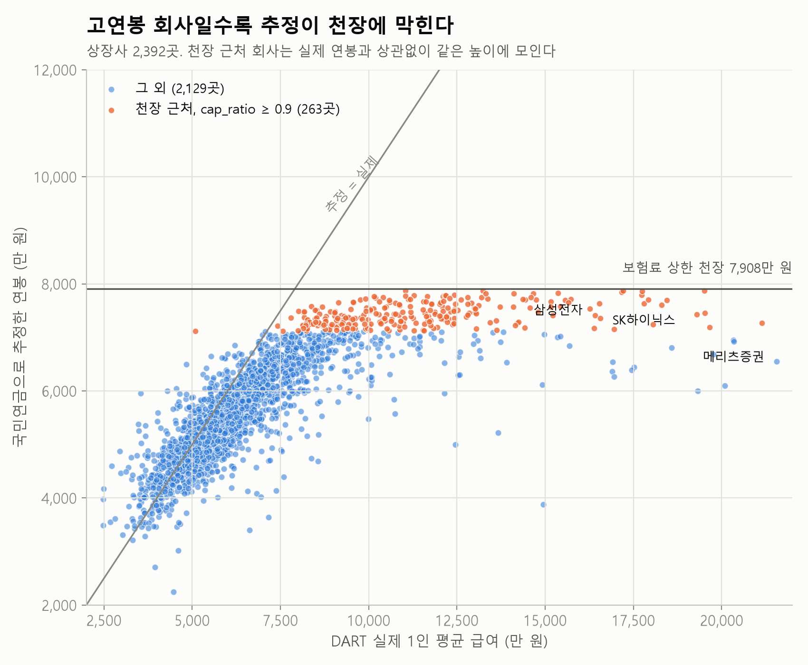
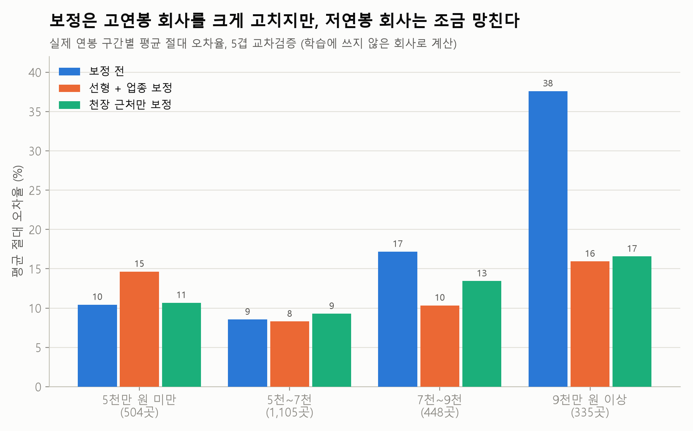
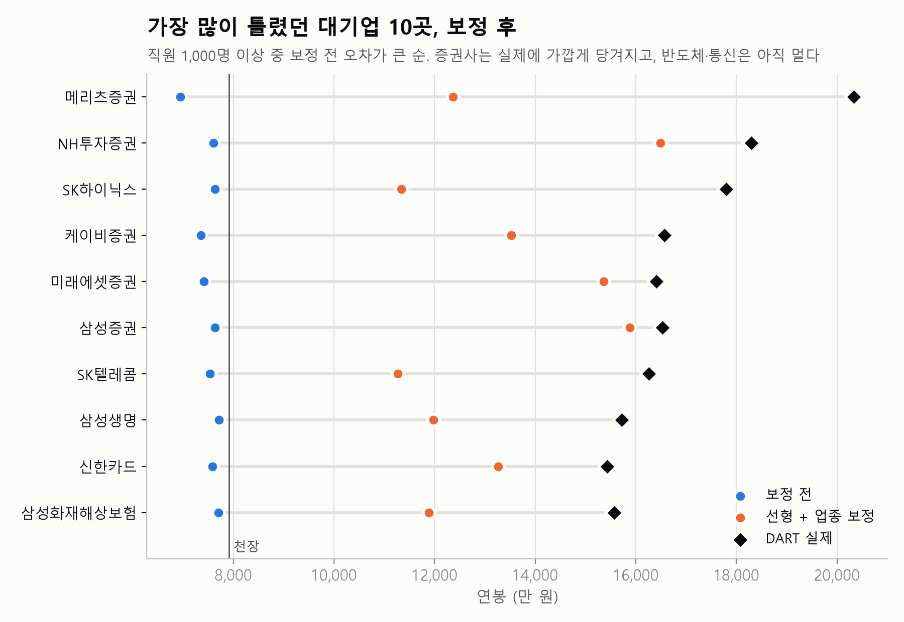

# 국민연금 데이터로 회사 연봉 추정하기 — 그리고 그 추정은 얼마나 맞을까?

국민연금 가입 사업장 데이터로 회사별 평균 연봉과 퇴사율을 추정하고, DART 사업보고서의 **실제 1인 평균 급여**로
오차를 측정·보정한 뒤, 그 결과를 **AI 에이전트(MCP 도구)** 로 제공하는 프로젝트.

## 핵심 결과
- 상장사 **2,392곳**으로 검증: 1차 추정의 평균 절대 오차율 **14.6%** → 보정 후 **11.1%** (5겹 교차검증)
- 오차의 대부분은 국민연금 보험료 **상한 천장**(연 7,908만 원) 때문. 천장 근처 회사는 31.9% → 13.5%
- 순위 상관 **0.88**: 금액보다 **회사끼리 비교**하는 용도에 더 믿을 만하다
- 결과를 도구 6개로 만들고, **에이전트 반복 구조를 직접 구현**(Gemini 무료 API, 모델 교체 가능)
- 질문 28개 **자동 평가**: 지어낸 숫자를 잡아내는 채점기로 실패 원인을 찾아 고침 (최종 27/28, 96%)
- **누구나 쓰는 웹 서비스**로 배포: https://yeon-salary-agent.streamlit.app (무료 AI 한도 때문에 비밀번호가 걸려 있음)
  — 브랜드명 검색, 업종·지역·규모 필터, 정확도 신호등, 2025년 12개월 퇴사율·직원 수 추이, 비슷한 회사 추천





> 이 프로젝트를 처음부터 만든다면 쓸 수 있는 전체 프롬프트: [docs/project_prompt.md](docs/project_prompt.md)

## 목차
1. [왜 이 프로젝트인가](#1-왜-이-프로젝트인가)
2. [데이터](#2-데이터)
3. [방법](#3-방법)
4. [결과](#4-결과)
5. [AI 에이전트](#5-ai-에이전트)
6. [시행착오와 배운 점](#6-시행착오와-배운-점)
7. [한계와 다음 과제](#7-한계와-다음-과제)
8. [실행 방법](#8-실행-방법)

---

## 1. 왜 이 프로젝트인가
- 취준생은 "이 회사 연봉·퇴사율 괜찮나?"를 궁금해하지만, **비상장사는 공식 정보가 거의 없다.**
- 국민연금 데이터로 연봉을 추정하는 방법은 알려져 있지만, **추정이 얼마나 틀리는지 검증한 사례는 드물다.**
  (GitHub 공개 저장소 기준, 2026-11 확인: 추정만 하는 개인 프로젝트 2건)
- 차별점: **추정 → 정답(DART)과 비교 → 어디서 틀리는지 분석 → 보정 → 에이전트로 제공**

## 2. 데이터
| 데이터 | 출처 | 규모 | 용도 |
|---|---|---|---|
| 국민연금 가입 사업장 내역 (2026-09) | 공공데이터포털 (data.go.kr/data/15083277), 월간 CSV | 589,413행 | 가입자 수, 고지금액, 신규취득·상실자 수 |
| 사업보고서 직원 현황 (2025) | OpenDART `empSttus` | 상장사 4,010곳 조회 | 1인 평균 급여 (정답 데이터) |
| 기업개황 | OpenDART `company` | 2,678곳 | 사업자번호 전체, 정식 이름 (매칭용) |
| 기업 고유번호 | OpenDART `corpCode.xml` | 119,894곳 | 회사명 → DART 고유번호 |

**데이터의 함정 (공식 설명 + 직접 확인)**
- 사업자등록번호는 **앞 6자리만** 공개. 한 번호를 최대 877개 사업장이 공유한다(앞 3자리가 세무서 코드)
- 고지금액에는 **기준소득월액 상한**(2026.7~ 월 659만 원)이 적용돼, 추정 연봉은 연 7,908만 원을 넘을 수 없다
- 신규취득자에는 납부 재개, 상실자에는 납부 예외가 섞여 있어 실제 입·퇴사자 수와 다르다
- 업종코드 13%가 `999999`(사업자번호 없는 학교·공공기관 등)
- 국민연금은 **법인명**으로 등록돼 브랜드명과 다르다 (토스 → 비바리퍼블리카, 엔씨소프트 → 엔씨)

## 3. 방법
```
국민연금 CSV ──► 품질 점검 ──► 회사명 정규화·지점 합치기 ──► 1차 추정
                                                              │
DART 직원 현황 ──► 합계 줄 처리·검증 ──► 매칭(97.7%) ◄─────────┘
                                          │
                            오차 분석 ──► 보정 모델 ──► 전체 51만 회사에 적용 ──► MCP 도구 5개
```

**1차 추정**
```
추정 연봉 = 당월고지금액 ÷ 가입자 수 ÷ 보험료율(9.5%, 2026.1~) × 12
cap_ratio = 평균 기준소득월액 ÷ 상한   (1에 가까울수록 천장에 막혔을 가능성)
```

**회사명 정규화** (`src/companies.py`): 법인 형태 제거(주식회사, (주), 농업회사법인, 법무법인 …),
`미원상사(주)전주공장` 같은 지점 이름 분리, `/일용/OO공사` 같은 일용직 현장 분리 →
등록 사업장 552,725곳을 회사 **515,431곳**으로 정리. 사업장이 가장 많은 회사는 아파트 관리 회사(우리관리 808곳).

**DART 정리** (`src/dart_parse.py`): 사업부문별 줄과 합계 줄을 함께 적는 회사가 있어,
급여가 있는 줄만, 합계 줄이 있으면 합계 줄만 쓴다. 총액÷인원과 줄별 평균이 20% 넘게 다르면 제외 → **2,678곳**.

**매칭** (`src/match.py`)
1. 사업자번호 앞 6자리가 같은 회사 중 이름 유사도 0.85 이상. 영문 약자는 한글로(SK하이닉스 → 에스케이하이닉스),
   종목명과 정식 이름(한화생명 / 한화생명보험) 둘 다 비교
2. 없으면 이름이 같은 회사 중 하나뿐이거나 가장 큰 곳이 5배 이상 클 때
3. 이름·업종이 같고 사업자번호만 다른 공장·지점은 합친다 (기아: 사업자번호 4종 → 1곳)

## 4. 결과

### 매칭
2,678곳 중 **2,617곳(97.7%)** 매칭. 직원 수가 서로 0.5~2배 안에 드는 믿을 만한 매칭 **2,392곳(91.4%)** 을 검증에 썼다.

### 1차 추정의 오차 (`reports/compare.md`)
- 평균 절대 오차율 **14.6%** (95% CI 14.1~15.2%), 중간값 11.1%, **79%의 회사에서 낮게 추정**
- 실제 평균 급여가 천장을 넘는 회사 527곳(22%)의 평균 오차 **-31.0%**, 나머지 **-4.8%**
  → "오차의 대부분은 상한 천장 때문"이라는 가설이 숫자로 확인됨
- 가장 많이 틀린 곳은 성과급 비중이 큰 **증권사**(메리츠증권 -66%, NH투자증권 -58%)와 SK하이닉스(-57%)

### 보정 모델 (`reports/model.md`)
비상장 회사에도 써야 하므로 **국민연금 데이터에 있는 변수만** 썼다: 1차 추정(로그), cap_ratio(0.8·0.9에서 꺾임),
가입자 수(로그), 월 퇴사율, 업종코드 앞 2자리.

| 모델 (5겹 교차검증) | 평균 절대 오차율 (95% CI) | 중간값 | 평균 오차 | 오차 10% 이내 |
|---|---|---|---|---|
| A 1차 추정 | 14.6% (14.1~15.2%) | 11.1% | -10.5% | 46% |
| B 선형 보정 | 11.5% (10.9~12.0%) | 8.2% | +1.5% | 58% |
| **C 선형 + 업종** | **11.1% (10.5~11.7%)** | **7.7%** | +1.4% | **61%** |
| D 그래디언트 부스팅 | 11.5% (10.9~12.1%) | 7.9% | +1.7% | 60% |
| E 혼합 (cap_ratio ≥ 0.8만 C) | 11.4% (10.9~12.0%) | 8.7% | -3.9% | 56% |

- C가 MAPE를 **3.5%p** 줄였다 (짝지은 부트스트랩 95% CI 3.1~4.0%p). 천장 근처 회사 31.9% → 13.5%
- 복잡한 모델(D)이 단순한 선형(C)보다 낫지 않았다. 2,392곳 규모에서는 단순한 모델로 충분
- **트레이드오프**: C는 실제 연봉 5천만 원 미만 구간에서 10.4% → 14.6%로 나빠진다. 그래서 천장 근처만 보정하는 E를
  만들었다. 조회 대상은 대부분 비상장·저연봉 회사라 **학습 데이터(상장사)와 사용 데이터의 분포가 다르다**는 점을
  고려해 서비스에는 E를 쓴다. E의 기준 0.8은 결과를 보고 정해 약간 낙관적일 수 있다.

### 남은 질문: 저연봉 회사는 왜 높게 추정됐나 (`reports/low_salary_check.md`)
실제 연봉 5천만 원 미만 회사는 1차 추정이 평균 **+5.5%** 높았다.
- 가설 1 "DART는 계약직·단시간 근로자까지 포함해 평균이 낮다" → **기각**. 저연봉 회사의 계약직 비율(중간값 2.0%)이
  오히려 낮고, 계약직 비율과 오차의 순위 상관은 -0.05로 관계가 없었다.
- 가설 2 "실제 값으로 구간을 나눠서 생긴 통계적 착시(평균으로의 회귀)" → **지지**. 같은 회사들을 **추정값**으로
  나누면 5천만 원 미만 구간의 평균 오차는 **-3.1%** 로 바뀐다.

| 구간 | 실제 연봉으로 나눴을 때 | 추정 연봉으로 나눴을 때 |
|---|---|---|
| 5천만 원 미만 | +5.5% | -3.1% |
| 5천~7천 | -7.0% | -9.7% |
| 7천 이상 | -25.9% | -28.9% |

→ "저연봉 회사를 높게 추정한다"는 대부분 착시였다. 같은 이유로, 위 보정 모델의 **구간별** 비교(실제 연봉 기준)도
이 효과의 영향을 받는다. 전체 MAPE 비교는 영향을 받지 않는다.

### 여러 달 데이터로 더 정확해질까? → 핵심은 '소득 연도 맞추기'였다 (`src/monthly.py`, `src/lag_check.py`, `src/compare_monthly.py`)
가설: 한 달 대신 여러 달을 평균하고, 정답(DART 2025 연간 급여)과 시기를 맞추면 더 정확해진다.
2025년 1~12월 파일 12개와 2026년 7~8월 파일을 더 받아 비교했다.

| 국민연금 자료 기간 | 기준이 되는 소득 연도 | DART 2025와 평균 절대 오차율 |
|---|---|---|
| 2025년 1~6월 평균 | 2023년 | 18.9% |
| 2025년 7~12월 평균 | 2024년 | 16.5% |
| 2025년 1~12월 평균 | 2023~2024년 | 17.6% |
| 2026년 9월 (지금까지 쓰던 자료) | **2025년** | 14.6% |
| 2026년 7~9월 평균 | **2025년** | 14.6% (0.1%p 개선) |

- **가설은 틀렸다.** 2025년 12개월 평균은 오히려 더 나빴다(14.7% → 17.6%, 같은 회사 2,292곳).
- 원인: 기준소득월액은 매년 봄 회사가 신고한 **전년도 소득**으로 정해져 **7월부터 1년간** 쓰인다.
  그래서 2025년 7~12월 자료는 2024년 소득, 1~6월은 2023년 소득이다. 같은 회사의 추정 연봉이 7월에
  중간값 +3.8% 한 번에 오르는 것도 이 때문이다. DART 2025와 같은 해 소득은 **2026년 7월 이후** 자료다.
- 같은 소득 연도 안에서는 달마다 거의 변하지 않아(변동계수 중간값 0.3%) 여러 달을 평균해도 0.1%p밖에 나아지지 않았다.
- 결론: 연봉 추정에는 **최신 7월 이후 한 달**이면 충분하고, 1~6월에 조회하면 2년 전 소득이라 낮게 나올 수 있다.
  앞서 한계로 적었던 "두 데이터의 시기가 다르다"는 문제는 사실 없었다(2026-09 자료 = 2025년 소득).
- 여러 달 데이터는 연봉보다 **퇴사율**을 안정적으로 보는 데 쓸 수 있다 (다음 과제).
- 참고: 2025년 6월부터 사업장 수가 약 4만 곳 늘었다(49만 → 53만). 자료 제공 범위가 바뀐 것으로 보인다.

```
bash src/download_months.sh                  # 2025년 1~12월 파일 (약 1.3GB)
python src/monthly.py                        # 2025년 → data/processed/monthly_companies.parquet
python src/monthly.py 2026                   # 2026년 7~9월 (같은 폴더에 nps_2026-07/08/09.csv)
python src/lag_check.py                      # 자료 기간별 오차 → reports/lag_check.md
python src/compare_monthly.py 2025           # → reports/monthly.md
python src/compare_monthly.py 2026           # → reports/monthly_aligned.md
```

## 5. AI 에이전트
분석 결과를 **도구 6개**로 만들고(`src/mcp_server.py`), 두 가지 방식으로 에이전트를 붙였다.

| 방식 | 두뇌(판단) | 반복 구조 | 용도 |
|---|---|---|---|
| **직접 만든 에이전트** (`src/agent.py`) | Gemini 무료 API | **직접 구현** | 평가, 포트폴리오 데모 |
| MCP 서버 | Claude 앱 | Claude 앱이 담당 | Claude에서 바로 쓰기 |

### 직접 만든 에이전트 (`src/agent.py`)
```
질문 → 모델(도구 설명과 함께) → 모델이 도구 호출 요청 → 우리 코드가 실행 → 결과를 모델에 돌려줌 → … → 답
```
- **모델 교체**: 대화 기록을 공통 형식으로 저장하고 모델별 변환은 Provider 클래스가 맡는다. 지금은 Gemini만 있고
  같은 형식으로 Claude·로컬 모델을 추가할 수 있다
- **자동 전환**: 모델이 바쁘거나(503) 하루 무료 한도를 다 쓰면(429) 다음 모델로 넘어간다.
  2026-11 기준 `gemini-3.5-flash`는 무료로 **하루 20번**뿐이라 평가는 `gemini-3.5-flash-lite`로 했다
- **오류 처리**: 없는 회사·도구를 부르면 오류 내용을 모델에 돌려줘 스스로 고치게 한다
- **기록**: 도구 호출, 인자, 결과, 소요 시간, 토큰을 남겨 평가에 쓴다
- MCP 서버와 **같은 도구 코드, 같은 안내문**을 쓴다. 한 곳만 고치면 양쪽에 반영된다

### 에이전트 평가 (`src/evaluate.py`, `eval/questions.json`, `reports/eval/`)
질문 28개(조회 11, 비교 4, 업종 2, 방법 3, 범위 밖 3, 주의 1, 지역 2, 추천 1, 퇴사율 1)를 묻고 사람이 읽지 않아도 자동으로 채점한다.
웹 기능을 넣으며 지역·비슷한 회사·12개월 퇴사율·브랜드명·소규모 사업장·기준 날짜 질문 7개(q22~q28)를 더했다.
직접 써보다가 발견한 문제(q21 "현대자동차 어때")도 질문으로 추가해, 같은 문제가 다시 생기지 않는지 계속 확인한다.

| 기준 | 무엇을 보나 |
|---|---|
| 올바른 회사 | 도구에 넘긴 company_key가 정답 회사인지 (토스 → 비바리퍼블리카) |
| 올바른 도구 | 정확도 질문에 method_and_limits를 불렀는지 등 |
| 오차 범위 | 답에 "A ~ B" 범위가 있는지 |
| 꼭 할 말 | 토스의 입·퇴사 경고, "신입 초봉이 아니라 회사 평균" 같은 말이 있는지 |
| **숫자 근거** | 답에 나온 금액이 **모두 도구 결과에 있는 값인지** (지어낸 숫자 잡기) |
| 한글 답변, 완료 | 한국어로 답했는지, 호출 한도 안에 끝냈는지 |

**결과** (`gemini-3.5-flash-lite`, 모든 회차를 최종 채점 기준으로 다시 채점해 비교)
| 회차 | 바꾼 것 | 모든 기준 통과 |
|---|---|---|
| 1회 | 처음 버전 | 18/20 (90%) — 실제 오류 2건 |
| 2회 | 금액 한글 표기를 도구가 제공, 숫자 뜻 설명 | 20/20 (100%) |
| 3회 | 현대자동차 오류 수정, 규모별 오차 범위, 50% 범위 추가, 질문 1개 추가 | 21/21 (100%) |
| 4회 | 웹 기능용 도구·안내문 크게 변경 (지역, 비슷한 회사, 12개월 퇴사율, 신호등), 질문 7개 추가 | 24/28 (86%) — 새 질문 7개는 모두 통과, 기존 질문 4개 실패 |
| 5회 | 4회에서 찾은 문제 고침 (아래 표) | **27/28 (96%)** |

질문당 평균 모델 2.8번·도구 2.0번 호출, 약 8,200토큰, 약 8초 (5회 기준). 도구 결과에 퇴사율·지역 정보가 늘어 토큰이 3회(약 5,000)보다 늘었다.

**4회에서 찾아 고친 것** — 기능을 늘리면 예전에 통과하던 질문이 깨질 수 있다는 걸 평가로 확인했다
| 발견 | 원인 | 고친 방법 |
|---|---|---|
| 보험료 상한을 "월 617만 원"(2025년 값), "월 790만 원"(틀린 값)으로 답함 | 상한이 도구 결과에 없는 질문에서 모델이 **기억으로** 씀 | 안내문과 업종 순위·방법 도구 결과에 지금 상한(월 659만 원)을 넣음 |
| 정확도 질문에 검증 수치(14.6% → 11.1%)를 빼고 답함 | 수치가 큰 표 안에만 있었음 | 한 문장(`accuracy_text`)으로 만들어 주고 "꼭 넣으라"고 지시 |
| 게임 회사 질문에 작은 게임사만 답함 | 대형 게임사는 '응용 소프트웨어' 업종인데, '게임' 회사가 10곳 넘게 잡혀 안내가 안 나감 | '게임' 키워드면 대형 게임사를 이름으로 찾아 비교하라고 결과에 적어 줌 |
| 토스 질문이 "입·퇴사 경고 없음"으로 실패 | 12개월 퇴사율로 바꾼 뒤엔 "퇴사율 57%, 직원 급증"으로 설명 — 답은 더 좋아졌는데 **채점 기준이 옛날 단어**만 찾음 | 채점 기준을 넓힘 |
| "약 1억 2,000만 원"(실제 1억 2,009만)을 지어낸 금액으로 잡음 | 채점기 오류 | '약'이 붙은 딱 떨어지는 금액은 반올림 폭만큼 허용 |

**남은 실패 1개 (q13)**: 게임사 5곳을 비교하며 한 회사 금액을 "1억 399만 원"으로 옮겨 적었다(범위 시작보다 작은, 있을 수 없는 값).
모델이 숫자를 옮기다 틀리는 문제는 완전히 막지 못해서, **웹에서는 답 속 금액을 도구 결과와 자동으로 대조해 다르면 경고**를 띄우고
카드·그래프는 AI 글이 아니라 데이터에서 바로 그린다.

**평가로 찾아 고친 것**
| 발견 | 원인 | 고친 방법 |
|---|---|---|
| "1억 171만 원"을 "1억 71만 원"으로, "1억 1,399만 원"을 "1억 399만 원"으로 답함 | 작은 모델이 `10171`(만 원)을 억·만 표기로 **바꾸다가** 틀림. 숫자를 지어낸 게 아니라 변환 실수 | 도구가 `"1억 171만 원"` 텍스트를 미리 만들어 주고 "그대로 옮겨 쓰라"고 지시 |
| `cap_ratio 0.76`을 "최고액 납부자 76%"로 해석, 옛날 상한 금액(590만~617만 원)을 기억으로 답함 | 도구가 숫자의 뜻을 설명하지 않았음 | 이름을 `avg_income_vs_cap_pct`로 바꾸고 뜻과 현재 상한 금액을 함께 제공 |
| 채점기가 "약 1.41억 원"을 41억으로, "1억 원이 넘는"을 지어낸 금액으로 잡음 | 채점기 오류 | 소수 억 단위, 기준 금액 표현, 도구 설명 문장 속 금액을 처리 |
| **직접 써보다 발견**: "현대자동차 어때"에 400 오류 | 검색 결과에 업종명이 빈 회사가 있어 NaN이 그대로 API로 감. NaN은 JSON에 없는 값 | 빈 값을 None으로 바꾸고, 이 질문을 평가 세트에 추가 |
| 게임 회사 질문에서 에이전트가 업종을 바꿔 다시 찾아 넥슨코리아로 답했는데 실패로 채점 | 채점기가 "회사별 도구에 넘긴 회사"만 셌음 | 도구 결과에 나오고 답에 이름이 나온 회사도 인정 |

**오차 범위 개선**: 처음에는 평균 소득 구간만으로 범위를 정했는데, 같은 구간이어도 회사 규모에 따라 오차가 달랐다
(80% 범위 폭: 300명 이상 22~38%, 미만 32~63%). 큰 회사는 범위가 필요 이상으로 넓고 작은 회사는 실제보다 좁았다.
→ **평균 소득 구간 × 규모(300명 기준)** 로 나눠 계산하고(한 칸에 50곳 미만이면 소득 구간만 사용),
**50% 범위**("2곳 중 1곳", 가장 가능성 높은 범위)도 함께 보여준다. 예: 현대자동차 추정 1억 78만 원,
가장 가능성 높은 범위 9,276만~1억 1,237만 원, 넓게 보면 8,597만~1억 2,383만 원. 실제(DART)는 1억 3,114만 원으로
넓은 범위도 벗어난다 — 성과급 비중이 큰 회사는 보정 후에도 낮게 나오는 한계가 그대로 보이는 사례.

**한계**: 질문 28개를 한 번씩 돌린 결과다. 모델 답은 매번 조금씩 달라서, 더 믿을 만한 숫자를 얻으려면 질문을 늘리고
여러 번 반복해야 한다. 채점 기준도 직접 만든 규칙이라, 규칙이 못 잡는 오류(예: 엉뚱한 해석)는 사람이 읽어 확인했다.

### 웹 화면 (`app/streamlit_app.py`) — https://yeon-salary-agent.streamlit.app
직접 만든 에이전트에 대화형 웹 화면을 붙여 Streamlit Community Cloud(무료)에 배포했다. PC·휴대폰 모두 지원.

**사용자를 정해 놓고 기능을 골랐다**
| 사용자 | 궁금한 것 | 넣은 기능 |
|---|---|---|
| 취준생 | "이 회사 괜찮은 데야?" | 숫자 카드(추정 연봉·범위·직원 수·업종 내 위치), **2025년 1년 퇴사율**과 업종 중간값, 직원 수 추이 |
| 이직 준비 직장인 | "지금 회사보다 나은 곳?" | 회사 비교 그래프, **비슷한 규모·업종에서 연봉 더 높은 회사** |
| 지방 구직자 | "우리 지역 회사는?" | 지역 필터 (**그 지역 사업장 기준**), "현대제철 충남"처럼 회사+지역 질문 |
| 취준생 | "신입이면 얼마, 몇 년 차면 얼마?" | **연차별 참고 연봉** (1년 미만 → 10년 이상, 업종별 정부 통계 곡선 × 회사 평균, 점선 카드 = 참고용) |
| 공통 | "더 알아보려면?" | 공식 홈페이지(상장사 DART 공시 주소), 사람인·잡코리아 채용공고, 잡플래닛 리뷰 버튼 (블라인드는 재직자만 볼 수 있어 뺐다) |
| 만든 사람 | "실제로 도움이 되나?" | 답마다 **👍👎 "이 추정 도움이 됐나요?"**, 👎는 아쉬운 점 한 줄(선택). 구글 시트로 모은다 (`tools/feedback_sheet.gs`에 연결 방법) |
| 공통 | "이 숫자 믿어도 돼?" | **정확도 신호등** 🟢🟡🔴, 상장사는 실제 공시 연봉을 같이 표시, 데이터 기준 날짜 |

**첫 화면에서 바로 검색** (사용자 입장 점검 후 고침)
- 그림 배경 위 검색창 하나로 합쳤다. 회사 이름만 넣으면 AI 없이 1초 안에 결과, 질문이면 AI에게 (AI가 20초쯤 걸리는 동안 질문 속 회사의 결론을 먼저 보여준다)
- 결과는 맨 위 **한 줄 결론**(평균 연봉·실제 공시·업종 내 위치·정확도) → 그 아래 자세한 내용이 펼쳐져 있다
- 조건 필터(업종·지역·규모·연봉·**요즘 채용 많은 순** = 2025년 직원 순증가율)도 같은 검색창 아래에 둔다
- **내 연차** 슬라이더(0~20년 차 참고 연봉), 비교 표의 **신입·5년 차 참고** 칸, 오타 추천('현대자등차' → 현대자동차)
- **공유 주소**: `?q=회사이름`으로 열면 그 회사 결과가 바로 나온다
- AI가 안 되면(무료 사용량 초과 등) 질문 속 회사의 데이터만이라도 보여준다
- 범례는 색만이 아니라 모양을 말로 적는다(동그라미 = 추정, 세로 선 = 실제 공시)

**AI 없이 바로 쓰는 "회사 직접 찾기"** (무료·즉시)
- 이름 검색: **브랜드명 55개 사전**(토스 → 비바리퍼블리카, 배민 → 우아한형제들, 스타벅스 → 에스씨케이컴퍼니 등, 데이터에서 하나씩 확인)
- 조건 검색: 업종(1,232가지를 14개 묶음으로), 지역, 규모, 연봉대, 직원이 늘고 있는 회사, 상장사
- **직원 10명 미만 사업장은 같은 지역·업종끼리 묶어 평균**을 보여준다 (한 곳씩 보면 몇 명 소득에 크게 흔들려서)

**만들면서 정한 기준**
| 항목 | 기준과 이유 |
|---|---|
| 정확도 신호등 | 🟢 상장사이거나 300명 이상이면서 비슷한 상장사 검증 오차 10% 이하 / 🟡 그 밖 / 🔴 30명 미만 (검증한 상장사의 90%가 36명 이상) |
| 1년 퇴사율 | 2025년 1~12월 상실자 합 ÷ 평균 가입자. 한 달치는 개편 한 번에 흔들려서(토스 2026-09 한 달 13.7%) 12개월로 바꿈 |
| 지역 | 여러 시·도에 사업장이 있는 회사 2,052곳은 지역 몫만 계산. 삼성전자처럼 전국 직원을 사업장 한 곳으로 신고한 회사는 나눌 수 없다고 답한다 |
| 답 속 금액 | 평가 채점기와 같은 함수로 답 속 금액을 도구 결과와 대조해, 옮겨 적다 틀리면 경고를 띄운다 |
| 작은 회사 (참고용) | 20명 미만은 **수축 추정**(같은 지역·업종 20명 미만 회사 평균 쪽으로 당기기, 값 = (직원 수 × 회사 추정 + 10 × 평균) ÷ (직원 수 + 10))을 "참고용 · 검증 안 됨" 카드로 따로 보여준다. 10명 미만 상장사가 거의 없어 더 정확해지는지 확인할 수 없어서, 원래 추정은 바꾸지 않았다. 처음엔 모든 회사 평균으로 당겼다가 큰 회사 수준으로 끌어올리는 문제(3,452만 → 5,045만)를 보고 같은 규모끼리의 평균으로 바꿨다 |
| 연차별 참고 연봉 | 국민연금에는 사람별 근속이 없어 한 사람의 연차별 연봉은 직접 못 구한다. 그래서 고용노동부 고용형태별노동실태조사 2025(KOSIS DT_118N_PAYN49)의 **업종 × 근속 구간 임금 ÷ 업종 평균** 곡선을 쓰되, 회사 평균을 **회사의 평균 근속 위치**에 맞췄다(상장사는 사업보고서 평균 근속, 나머지는 같은 직원 규모의 평균 근속 5.9~10.8년(KOSIS DT_118N_PAY0004), 직원이 크게 늘어난 회사는 직원 수 추이로 본 최대치). 처음엔 업종 평균 대비 비율을 그대로 곱해서 근속이 긴 대기업의 신입이 크게 나왔다(카카오 7,679만 → 고친 뒤 6,738만, 삼성전자 평균 근속 13.7년 반영 9,857만 → 7,512만). 대기업은 성과급·주식 보상이 고참에게 몰려 있어 여전히 높게 나올 수 있다. 상장사 공시로 '평균 근속이 1년 긴 회사의 급여 차이'(직원 수 통제)도 업종별로 구해 비교했는데, 정부 통계는 근속 1년당 중간값 +5.2%, 상장사 비교는 +2.5%였다. 회사끼리 비교하면 근속이 짧아도 연봉이 높은 회사(IT 0%)가 섞여 작게 나오므로, 곡선은 정부 통계를 쓰고 상장사 값은 비교로만 적는다 (`src/tenure_check.py`, `reports/tenure_check.md`) |
| 회사 평균 연도별 변화 | 해마다 9월 자료(2019~2025년 소득)로 같은 회사의 평균을 다시 계산했다. 직원이 크게 늘면 평균이 내려가 보이고(토스 407명 → 2,270명), 상한에 걸린 회사는 상한 인상분만큼만 오르는 것처럼 보여 메모를 붙였다. "한 사람의 연차별 연봉이 아니다"라고 이름에 적었다 (`src/make_trend_data.py`) |
| 작은 브랜드 | 라라스윗처럼 2026-09 자료에 이름이 없으면, 사업자등록번호 앞자리가 같은 사업장(오디너리)을 "추정 연결"로 안내한다. 확인 안 된 연결은 따로 표시한다 (`src/brands.py`) |
| 10명 미만 (목록) | 조건 검색 표에서는 한 곳씩 빼고, 맨 아래 **"기타" 한 줄**로 묶어 평균과 가운데 50% 범위를 보여준다 |

**배포하며 고친 문제**
| 문제 | 원인 | 고친 방법 |
|---|---|---|
| 일부 브라우저에서 비밀번호 칸·그래프 자리에 `Failed to fetch dynamically imported module` | 배포 직후 화면 부품 파일을 늦게 받음 | 그래프·표를 라이브러리 없이 HTML로 직접 그림 |
| 답 속 굵은 글씨가 `**…**` 그대로 보임 | Markdown은 닫는 `**` 앞이 괄호, 뒤가 한글이면 굵게 인식하지 못함 | `**…**`를 직접 굵은 글씨로 바꿔 그림 |
| "업종 상위 89%"로 답함 (실제 상위 11%) | 백분위를 거꾸로 읽음 | 도구가 "같은 업종 5,708곳 중 상위 11%" 문장을 만들어 줌 |

- 데이터: `src/make_app_data.py`(32MB), `src/make_region_data.py`(지역별 몫), `src/make_turnover_data.py`(12개월 퇴사율·직원 수 추이),
  `src/make_trend_data.py`(연도별 평균), `src/make_link_data.py`(홈페이지), `data/app/tenure_wage_2025.json`(정부 통계 연차 임금)으로
  만든 `data/app/`만 저장소에 올린다
- 비밀 값: `GEMINI_API_KEY`(AI 모델), `APP_PASSWORD`(무료 한도를 아무나 쓰지 않게), `FEEDBACK_URL`·`FEEDBACK_TOKEN`(피드백 시트, 선택)은 코드가 아니라 배포 서비스의 Secrets 설정에 넣는다
- 대화를 기억해 "그럼 카카오는?"처럼 이어서 물을 수 있고, 답마다 사용한 도구를 보여준다
```
~/venvs/pension/bin/streamlit run app/streamlit_app.py   # 로컬 실행 (WSL)
```

### MCP 서버 (`src/mcp_server.py`)
같은 도구를 MCP로 열어 Claude 앱에서도 쓸 수 있게 했다.

| 도구 | 하는 일 |
|---|---|
| `search_company` | 이름으로 후보 찾기. 브랜드명 사전, 영문 약자 한글 변환, 10명 미만 회사는 뒤로, 법인명이 검색어 앞부분인 큰 회사도 후보로 |
| `get_salary_estimate` | 추정 연봉, 50%·80% 오차 범위, 정확도 신호등, 2025년 1년 퇴사율·직원 수 추이, 업종 내 위치, 주의 사항, 상장사면 DART 실제 값. `region`을 주면 그 지역 사업장 몫, 10명 미만이면 같은 지역·업종 소규모 사업장 평균 |
| `similar_companies` | 같은 업종·직원 수 0.5~2배 회사 중 추정 연봉이 더 높은 곳 |
| `compare_companies` | 최대 5곳 비교 |
| `industry_ranking` | 업종 키워드로 상위 회사·오차 범위·업종 중간값 |
| `method_and_limits` | 추정 방법·검증 결과·한계 |

**설계에서 신경 쓴 점**
- 숫자만 주지 않고 **오차 범위와 주의 사항**을 함께 돌려줘서 AI가 과장해서 답하지 않게 했다
- 서버 안내문에 "법인명과 브랜드명이 다르다"는 점을 적어, 결과가 이상하면 AI가 법인명으로 다시 찾게 했다
- 오차 범위는 상장사 교차검증 결과의 cap_ratio 구간별 10~90% 분위수 ("비슷한 회사 10곳 중 8곳이 이 범위")

**에이전트 시험에서 찾아 고친 문제**
| 질문 | 문제 | 고친 방법 |
|---|---|---|
| "토스 평균 연봉?" | 한 달에 신규 571명·상실 311명(가입자의 25%·14%)인데 월 퇴사율 13.7%가 경고 없이 나갔다 (보통 회사 중간값 1.8%) | 입·퇴사가 한 달에 10%를 넘으면 "계열사 이동·조직 개편일 수 있다"는 주의 문구 |
| "엔씨소프트" | 법인명이 "주식회사 엔씨"로 바뀌어 검색 실패 | 법인명이 검색어 앞부분인 큰 회사도 후보로 |
| "게임 회사 연봉 순위" | 넥슨코리아·크래프톤·엔씨가 "응용 소프트웨어 개발" 업종이라 빠짐 | 결과가 적으면 "회사 이름으로 찾아 비교하라"는 안내를 돌려줌 |

실제 Claude 세션에서 MCP로 연결해 질문 3개에 답하게 했고, 도구 호출 12번이 모두 정상이었다. AI는 안내에 따라
토스를 법인명으로 찾았고, 게임사는 이름으로 찾아 비교했다. DART 값이 있는 게임사 4곳(엔씨, 크래프톤, 카카오게임즈,
넷마블)은 모두 오차 범위 안에 들었다.

## 6. 시행착오와 배운 점
| 틀렸던 것 | 무엇이 문제였나 | 배운 점 |
|---|---|---|
| "일용직 사업장은 연봉이 낮을 것" | `공사`라는 단어로 찾았더니 한국전력공사 같은 공기업까지 걸렸고, 고친 뒤에도 일용직 현장이 오히려 높았다 | 단어 규칙은 반드시 예외를 눈으로 확인한다 |
| 법인 형태 목록 | `농업회사법인`이 빠져 1,455개 회사가 이름 하나로 뭉쳤다 | 정규화 후 가장 큰 그룹부터 점검한다 |
| DART 직원 수 | 삼성전자가 257,762명(실제의 2배)으로 계산됐다 — 합계 줄 중복 | 원본 줄을 직접 열어본다 |
| 공장·지점 | 기아가 사업자번호 4종으로 쪼개져 직원 수가 안 맞았다 | 매칭 결과를 규모로 교차 검증한다 |
| "저연봉 회사는 높게 추정된다" | 구간을 실제 값으로 나눠서 생긴 착시였다 | 구간 분석은 무엇을 기준으로 나눴는지부터 의심한다 |
| "여러 달을 평균하면 더 정확하다" | 2025년 12개월 평균이 오히려 나빴다. 국민연금 소득은 전년도 소득이라 시기가 1년씩 밀려 있었다 | 데이터가 '언제의 값'인지, 제도가 어떻게 정해지는지부터 확인한다 |
| 환경 | Windows 스마트 앱 컨트롤이 pandas를 차단 | 보안 설정은 그대로 두고 WSL로 분리, 그동안은 표준 라이브러리 + SQLite로 진행 |

## 7. 한계와 다음 과제
**한계**
- 회사 **전체 평균**이다. 직무·직급·개인 연봉이 아니다
- 검증은 상장사로만 했다. 작은 비상장 회사는 오차가 더 클 수 있다
- 성과급 비중이 큰 회사(증권, 반도체, 통신)는 보정 후에도 낮게 나온다 (SK하이닉스 -36%)
- 본사와 공장의 업종이 다르게 등록된 회사(한화솔루션, 고려아연 등)는 아직 하나로 합치지 못한다
- 퇴사율은 국민연금 **자격 상실** 기준이라 계열사 이동도 들어간다. 1년 퇴사율은 2025년 1~12월 값이다 (2026년 1~6월 파일은 받지 않았다)
- 지역은 **시·도**까지만 있고, 전국 직원을 사업장 한 곳으로 신고한 대기업은 지역별로 나눌 수 없다
- 업종 칸이 비어 있는 큰 회사(배민·당근 등 30명 이상 약 9천 곳)는 업종 필터에서 따로 골라야 한다
- 1~6월 자료는 2년 전 소득 기준이라, 그때 조회하면 추정이 실제보다 약 4% 더 낮게 나올 수 있다

**다음 과제**
- 업종이 다른 본사·공장 합치기 (주소·DART 사업부문 활용)
- 매월 새 파일(매달 25일 전후 등록)이 나오면 자동으로 다시 계산하고, 최근 12개월로 퇴사율 갱신
- 브랜드명 사전을 사람 손이 아니라 DART 기업개황·상표 데이터로 넓히기

## 8. 실행 방법
### 웹 화면만 바로 띄우기 (다른 PC에서) — 데이터 준비 없이 바로 된다
웹에 필요한 데이터(`data/app/`, 약 40MB)는 저장소에 들어 있다. **Python 3.12 이상**만 있으면 된다.

| 환경 | 방법 |
|---|---|
| **Windows** | `run_app.bat` 더블클릭 |
| **macOS · Linux · WSL** | `bash run_app.sh` |
| **Docker** (어디서나 같은 환경) | `docker build -t pension-salary .` → `docker run -p 8501:8501 --env-file .env pension-salary` |
| **설치 없이 브라우저에서** | GitHub 저장소 → Code → Codespaces → Create codespace (`.devcontainer` 설정으로 Python 3.12와 패키지가 자동 설치되고 앱이 뜬다) |

모든 방법이 **같은 Python 버전(3.12)과 같은 `requirements.txt`**를 쓴다 (`.python-version`, `Dockerfile`, `.devcontainer`).

- 처음 한 번은 가상환경(`.venv`)을 만들고 패키지를 설치해서 몇 분 걸린다. 그다음부터는 바로 열린다 → http://localhost:8501
- `.env`가 없으면 `.env.example`을 복사해 만든다. **AI 질문**을 쓰려면 `.env`의 `GEMINI_API_KEY`를 채운다
  (무료: https://aistudio.google.com/apikey). **키가 없어도 "회사 직접 찾기"(이름·조건 검색)는 쓸 수 있다**
- `APP_PASSWORD`를 비워 두면 비밀번호 없이 열린다
- 패키지는 `requirements.txt` **한 파일**로 분석·에이전트·웹을 모두 설치한다 (웹 배포도 같은 파일)

**다른 PC에서 안 열리던 문제와 대응** (사용자 피드백)
| 증상 | 원인 | 대응 |
|---|---|---|
| 비밀번호를 넣은 뒤 오류·빈 화면 | 비밀번호를 넣으면 51만 곳 데이터를 불러오는데, 새 버전이 배포될 때 옛 데이터와 새 데이터가 잠깐 두 벌이 돼 무료 서버 메모리가 부족해질 수 있었다 (최대 약 730MB) | 업종 묶음 열을 category로 바꿔 약 100MB 절약, 새 버전을 불러오기 전에 옛 데이터를 먼저 비움, 실패하면 "새로고침해 주세요" 안내 |
| 배포 직후 `KeyError` | 화면 코드는 새것, 캐시에 남은 계산 코드는 옛것 | 코드가 바뀌면 모듈을 다시 읽음 |
| 처음 열 때 30초~1분 로딩 | 무료 서버가 잠들었다 깨어남 | 정상. 잠시 기다리면 열린다 |
| 일부 브라우저에서 `Failed to fetch dynamically imported module` | 화면 부품 파일을 늦게 받음 (앱이 깨어나는 중이거나 네트워크 차단) | 그래프·표는 HTML로 직접 그림. 입력 칸에서 나면 새로고침(Ctrl+F5) |
| 남의 PC에서 받아 실행하면 꺼짐 | AI 키가 없으면 앱이 바로 종료됐다 | 키 없이도 열리고 AI 질문만 안내 문구 |

### 분석을 처음부터 다시 돌리기
**환경**: 이 프로젝트는 Windows 스마트 앱 컨트롤이 pandas를 차단해 **WSL Ubuntu**에서 만들었다. 다른 PC에서는 그냥 Python 3.12+ 가상환경이면 된다.
```
pip install -r requirements.txt
```

**데이터 준비** (원본·가공 데이터 약 400MB는 저장소에 넣지 않았다)
1. 공공데이터포털에서 "국민연금공단_국민연금 가입 사업장 내역" CSV → `data/raw/nps_2026-09.csv`
2. OpenDART 인증키 → `.env`에 `DART_API_KEY=...`
3. (에이전트) Google AI Studio 무료 키 → `.env`에 `GEMINI_API_KEY=...`

**실행 순서**
```
python src/load.py data/raw/nps_2026-09.csv   # CSV → SQLite (약 4초)
python src/quality.py                         # 품질 점검 → reports/quality.md
python src/estimate.py                        # 사업장 단위 1차 추정 → reports/estimate.md
python src/companies.py                       # 회사 단위 정리 → reports/companies.md
python src/dart.py corpcode                   # DART 기업 고유번호
python src/dart.py fetch 2025                 # 상장사 직원 현황 (약 25분, 이어받기 지원)
python src/dart_parse.py 2025                 # 회사별 1인 평균 급여
python src/dart.py company 2025               # 기업개황 (약 15분)
python src/match.py 2025                      # 매칭 → reports/match.md
python src/compare.py 2025                    # 1차 추정 오차 → reports/compare.md
python src/model.py 2025                      # 보정 모델 → reports/model.md
python src/low_salary_check.py 2025           # 남은 질문 확인 → reports/low_salary_check.md
python src/charts.py 2025                     # 차트 → reports/figures/
python src/serving.py 2025                    # 전체 회사 조회용 데이터
bash src/download_months.sh && python src/monthly.py   # 2025년 1~12월 월별 파일 (12개월 퇴사율용)
python src/make_app_data.py                   # 웹 배포용으로 작게 → data/app/
python src/make_region_data.py                # 회사 안 지역별 몫 → data/app/region_sites.parquet
python src/make_turnover_data.py              # 1년 퇴사율·직원 수 추이 → data/app/turnover_2025.parquet
python src/brands.py                          # 브랜드명 사전이 실제 회사로 연결되는지 확인
python src/try_tools.py                       # MCP 도구 시험
python src/agent.py "토스 평균 연봉 어느 정도야?"   # 직접 만든 에이전트에 질문
python src/agent.py --chat                    # 대화 모드 (앞 질문을 기억, "그럼 카카오는?")
python src/evaluate.py --model gemini-3.5-flash-lite  # 질문 28개 자동 평가 → reports/eval/
python src/evaluate.py --regrade reports/eval/gemini-3.5-flash-lite.jsonl   # 모델 호출 없이 다시 채점
```

**에이전트 연결**: `.mcp.example.json`을 `.mcp.json`으로 복사해 경로 두 곳을 내 환경에 맞게 바꾼 뒤,
이 폴더에서 Claude Code 세션을 열면 `company-salary` 서버 사용 여부를 묻는다.

**점검용 도구**: `src/spot_check.py`(회사 합치기 확인), `src/dart_inspect.py`(DART 원본 줄),
`src/match_debug.py`(국민연금 쪽 이름 검색), `src/check_pandas.py`(pandas·SQLite 결과 일치 확인)

```
pension-salary/
├── src/            수집·정제·분석·에이전트 코드
├── reports/        결과 보고서(md)와 차트(figures/)
├── app/            웹 화면 (Streamlit)
├── data/app/       웹 배포용 데이터 (저장소에 있음) — 원본(raw)·가공(processed)은 저장소에 없음
├── eval/           평가 질문
├── requirements.txt
└── .mcp.example.json
```
